

# Polygon Rain - Public Builds

**Polygon Rain** is a PS1-style 3D roguelite shooter set in a post-apocalyptic wasteland, in the spirit of *Risk of Rain 2* with Armored Core-era graphics. Play solo or with up to three friends in online co-op. Pick one of four mechs, drop in by pod, stack items, beat each stage's guardian and push on while the threat keeps rising, all the way to the Leviathan at Zero Point.

Latest version: **v0.30.0**

## Download

Grab the latest build from the **[Releases](https://github.com/Cluelessmate/PolygonRain-Builds/releases/latest)** page.

| Platform | File | Run |
|---|---|---|
| Windows 10/11 (64-bit) | `PolygonRain_vX.Y.Z_Windows.zip` | Unzip and run `PolygonRain.exe` |
| Linux (x86_64) | `PolygonRain_vX.Y.Z_Linux.zip` | Unzip, `chmod +x PolygonRain.x86_64`, run it |

If Windows SmartScreen warns about an unknown publisher, click **More info > Run anyway**. Each release lists SHA-256 checksums for both zips.

## Co-op (1-4 pilots)

Single player first, with optional online co-op. On the main menu pick **CO-OP**: one pilot presses *HOST GAME*
(default UDP port **24565**) and gets a **join code** (like `61FC-R310`) - press *COPY* and send it to your squad;
they paste it and press *JOIN*. No IP addresses to share. Players on the same network can use the faster
**LAN code**. Over the internet the host may need to forward UDP 24565 on their router. Set your **pilot name** on
the CO-OP page or in Settings; your squad sees it. Everyone needs
the same version. Hostiles and guardians scale with the squad, loot stays personal, and downed pilots are revived
by holding **[Interact]** beside them.

**Bots:** the host can fill empty seats with AI pilots (*+ ADD BOT*); they fight, revive you and replace anyone who
drops out mid-run.

**Steam:** with Steam running, sessions go through Steam - join codes work behind any router with no port forwarding, and the host can press *INVITE STEAM FRIENDS*.
Achievements unlock on Steam as you earn them.

## Screenshots

| | |
|---|---|
| 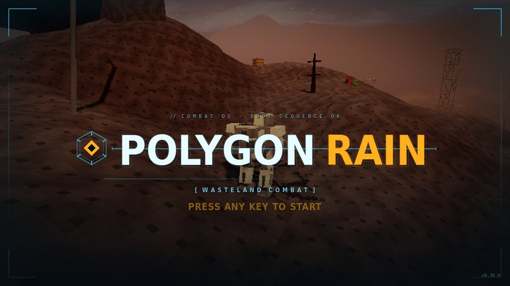 *Title screen* | 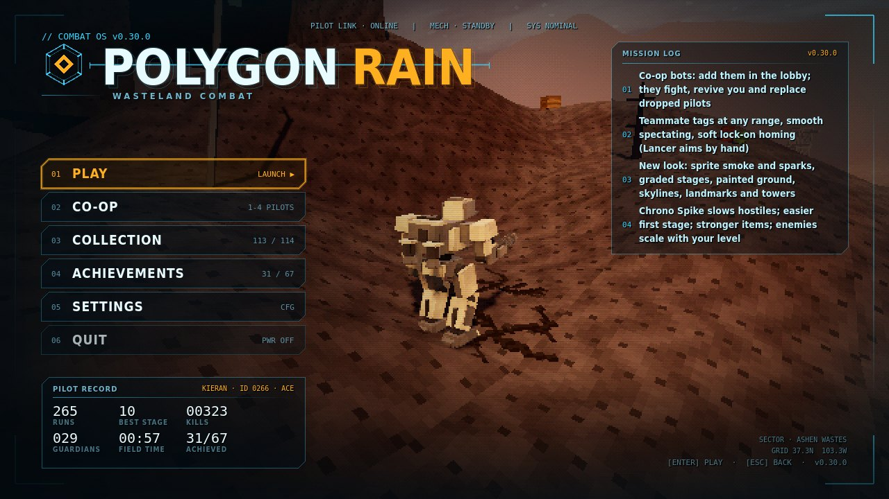 *Main menu with the v0.30 notes* |
| 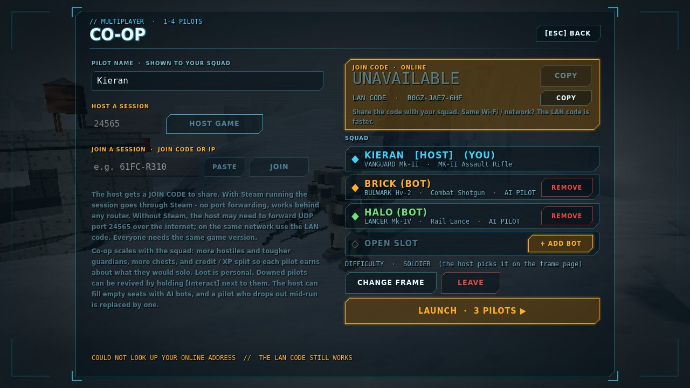 *Co-op lobby with two AI bots* | 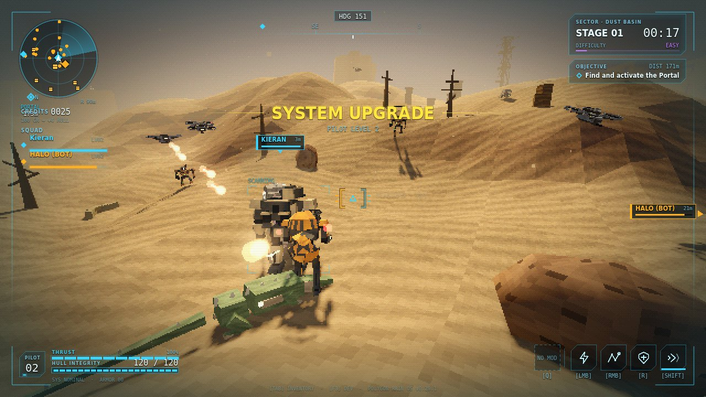 *Teammate tags at any range - off-screen pilots pin to the edge* |
| 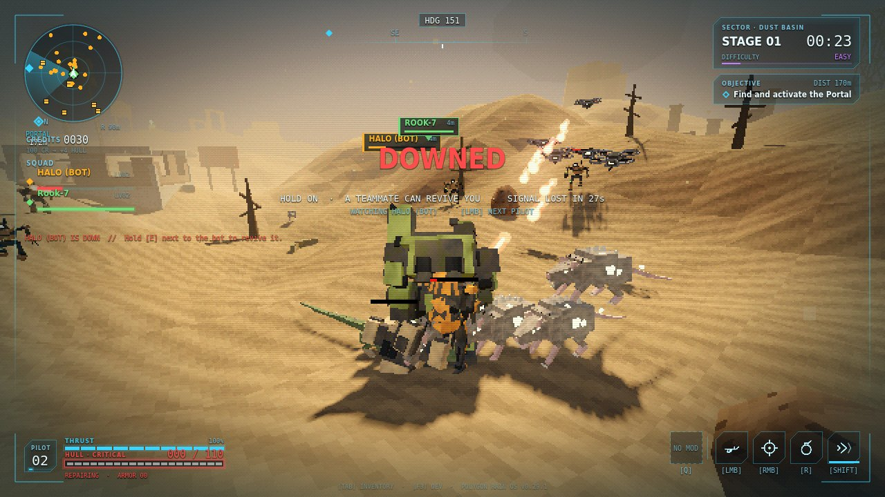 *Downed: watching a bot fight on, no camera shake* | 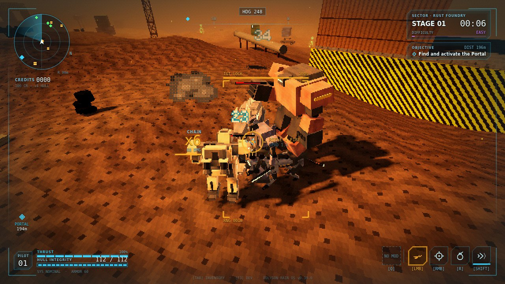 *Rust Foundry: sprite smoke and the new grade* |
| 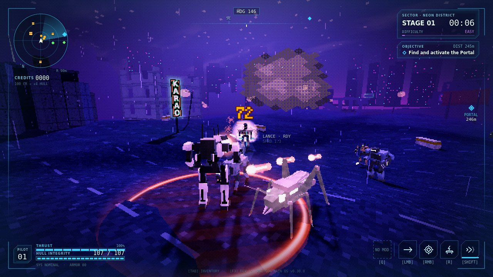 *Neon District skyline behind a Lancer fight* | 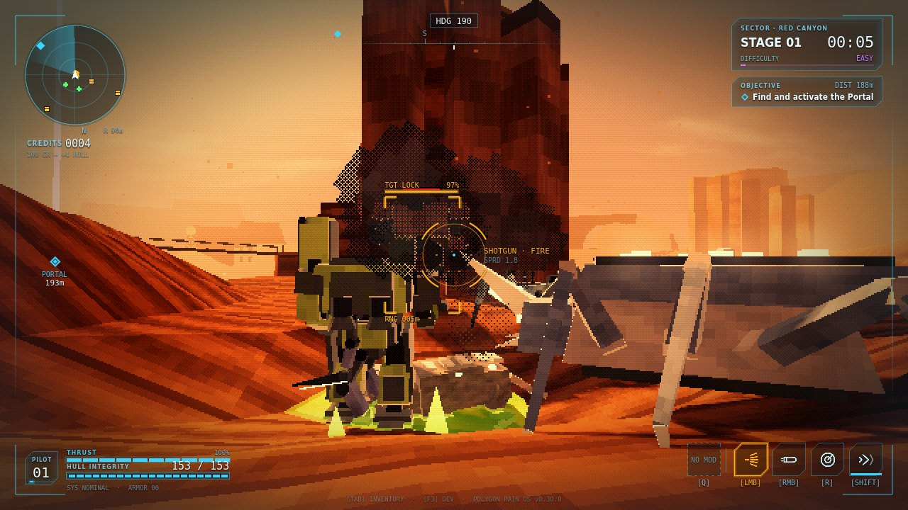 *Red Canyon mesas on the horizon* |
| 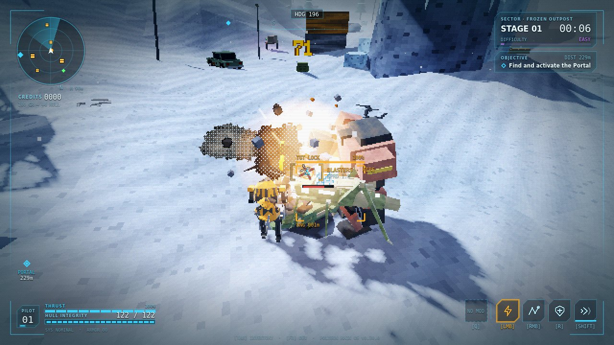 *Frozen Outpost with sprite debris* | 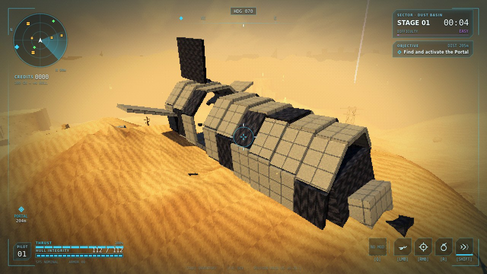 *Landmark: a crashed ship you can walk into* |
| 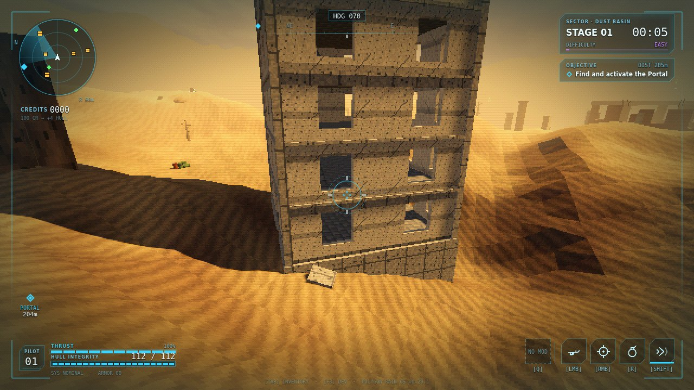 *Landmark: a 6-8 storey tower with ramps to the top* | 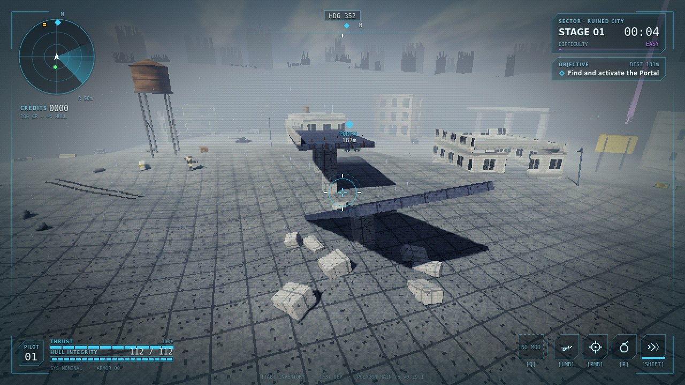 *Landmark: a collapsed overpass in the Ruined City* |
| 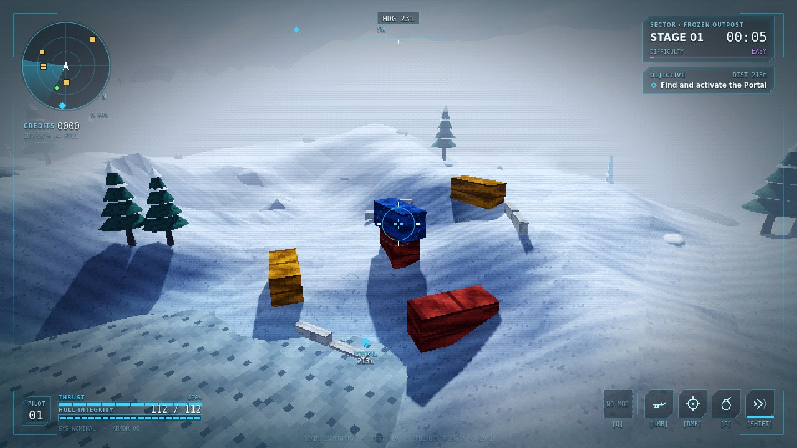 *Landmark: a barricaded container camp* | 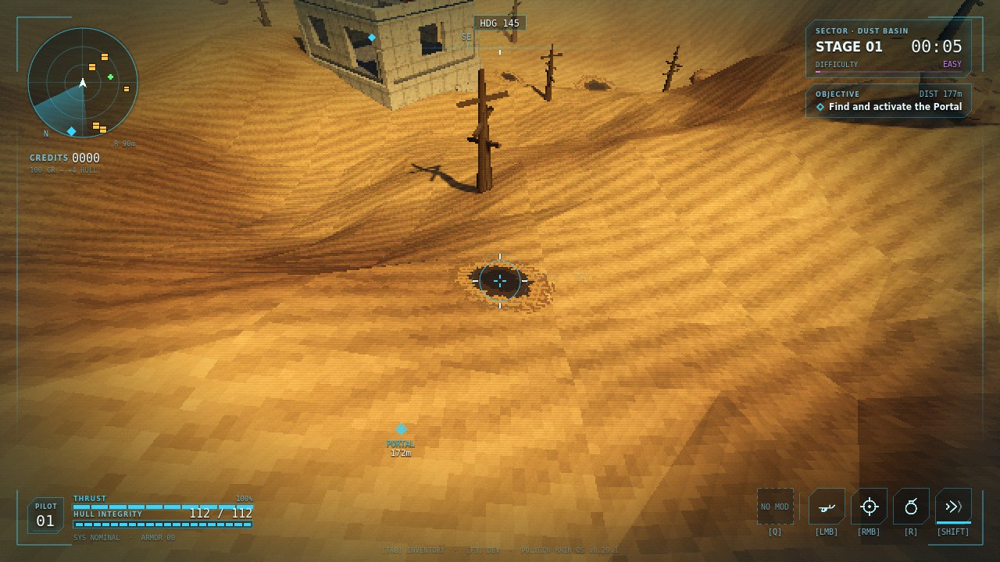 *Ground detail: craters, scorch marks and tracks* |
| 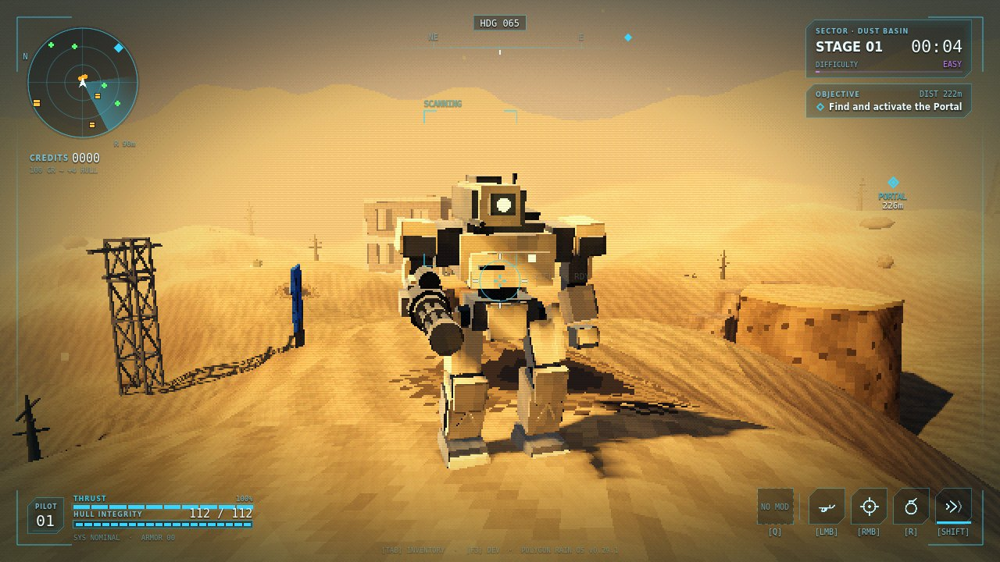 *Rim-lit mech with the PS1 texture pass* | 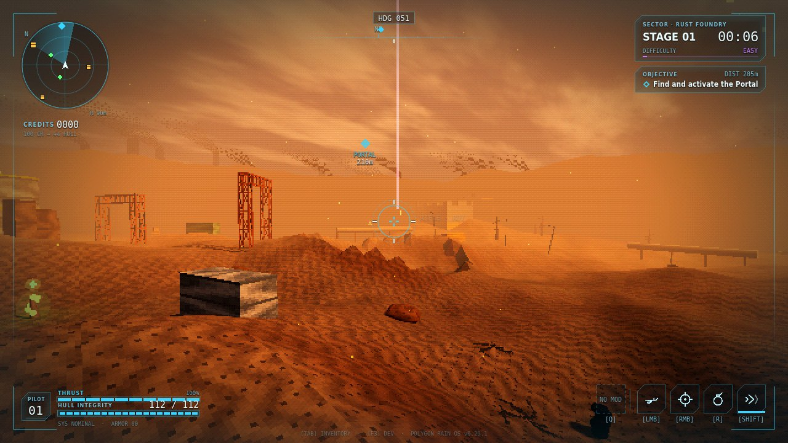 *Smokestacks and plumes on the Rust Foundry skyline* |

## Controls

| Key | Action |
|---|---|
| WASD | Move |
| Space | Jump / hold to jetpack-hover |
| Ctrl | Sprint (Tumbler: roll into a ball) |
| LMB / RMB | Primary weapon (Lancer: hold to charge) / alt shot: Pierce (Vanguard), Tag Bolt (Lancer), Slug Round (Bulwark), Ricochet Orb (Tumbler) |
| R | Grenade / missile pod / bubble shield (depends on the mech) |
| Shift | Dash |
| Q | Ultimate |
| E | Interact |
| G / Middle mouse | Ping |
| Tab | Inventory |
| Esc | Pause / settings |

Every key can be rebound in Settings > Controls, and controllers are supported. The drop pod intro can be skipped with jump or fire, or turned off in Settings > Controls > Interface.

## About this repo

This repository hosts playable builds plus the game's artwork and screenshots (`media/`). Each release includes the changelog and screenshots for that version.
