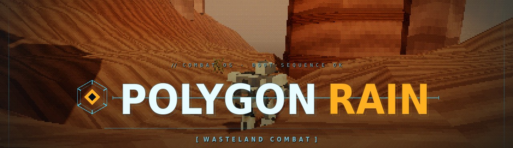
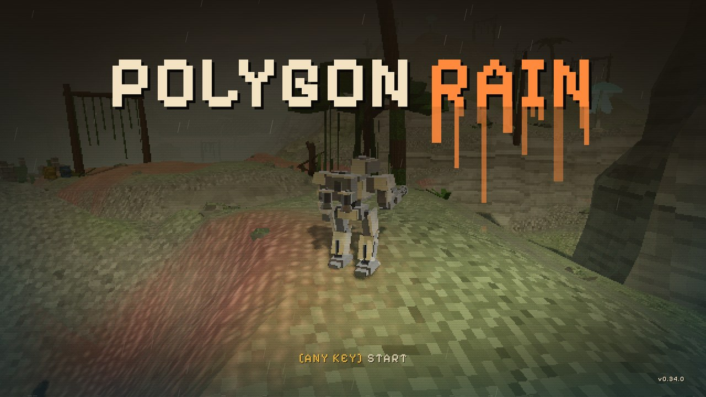
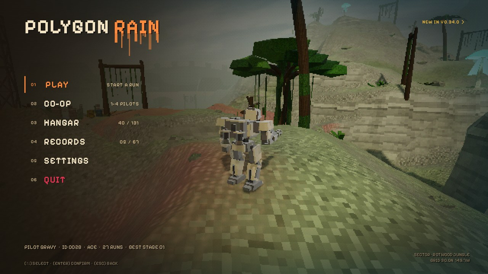
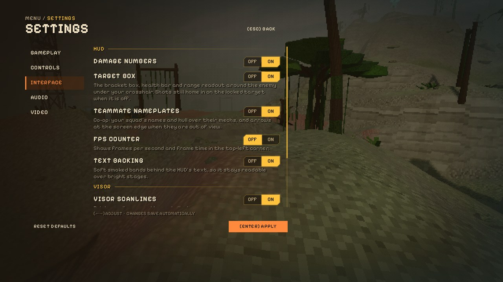
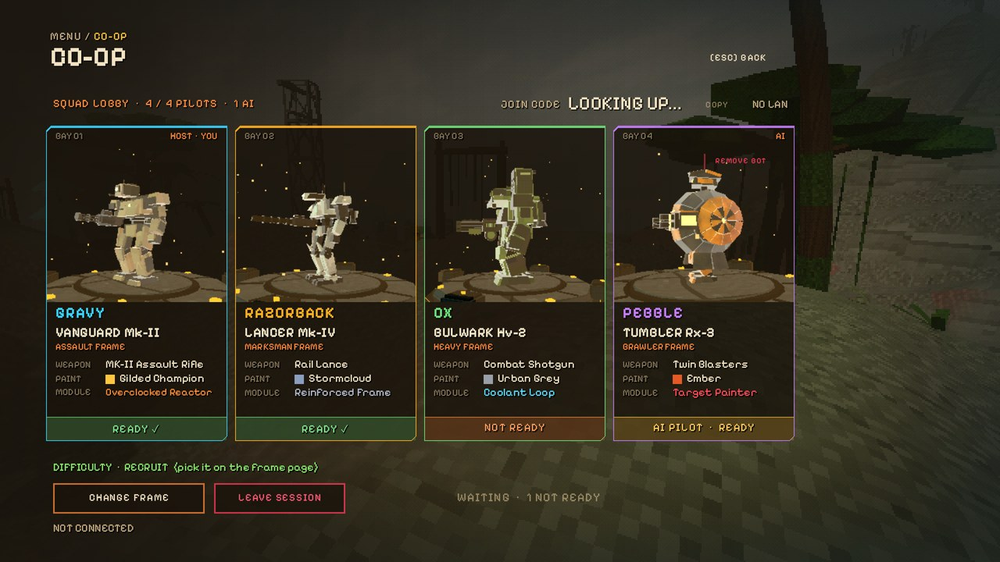
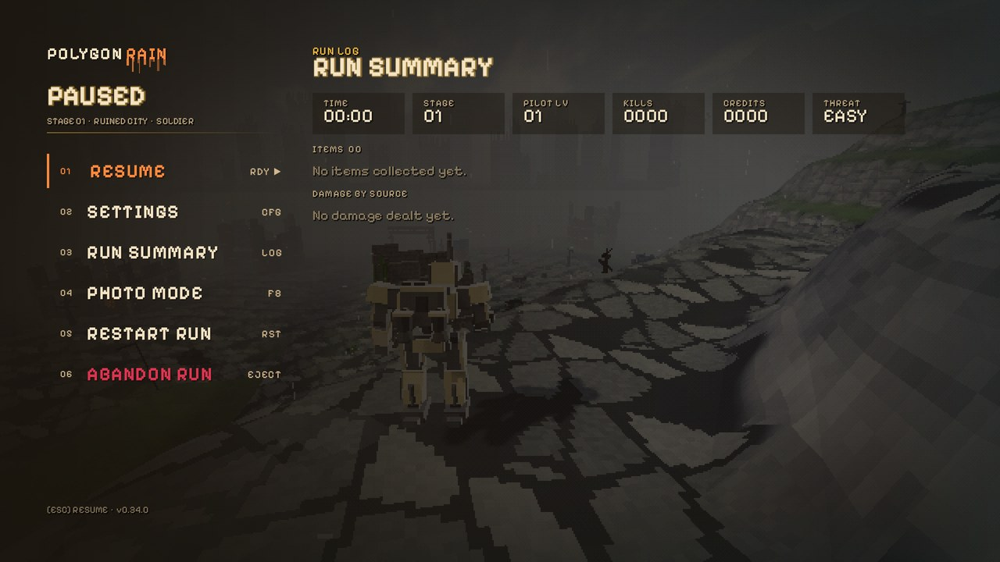
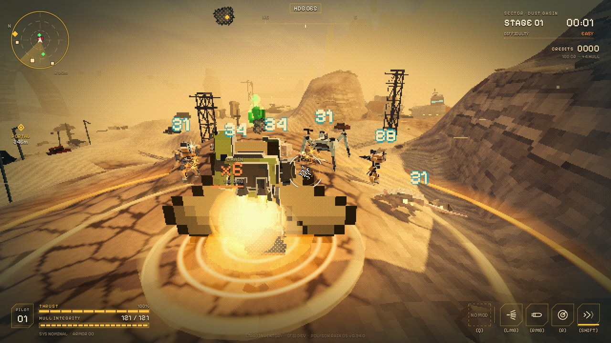

# Polygon Rain - Public Builds

**Polygon Rain** is a PS1-style 3D roguelite shooter set in a post-apocalyptic wasteland, with Armored Core-era graphics. Play solo or with up to three friends in online co-op. Pick one of four mechs, drop in by pod, climb cliffs and plateaus on ten stages - one of them underground - stack items, beat each stage's guardian and push on while the threat keeps rising, all the way to the Leviathan at Zero Point.

Latest version: **v0.35.0**

## Download

Grab the latest build from the **[Releases](https://github.com/Cluelessmate/PolygonRain-Builds/releases/latest)** page.

| Platform | File | Run |
|---|---|---|
| Windows 10/11 (64-bit) | `PolygonRain_vX.Y.Z_Windows.zip` | Unzip and run `PolygonRain.exe` |
| Linux (x86_64) | `PolygonRain_vX.Y.Z_Linux.zip` | Unzip, `chmod +x PolygonRain.x86_64`, run it |

If Windows SmartScreen warns about an unknown publisher, click **More info > Run anyway**. Each release lists SHA-256 checksums for both zips.

## Co-op (1-4 pilots)

Single player first, with optional online co-op. On the main menu pick **CO-OP**: one pilot presses *HOST GAME*
(default UDP port **24565**) and gets a **join code** (like `61FC-R310`) - press *COPY* and send it to your squad;
they paste it, press *JOIN* and then *READY UP*. No IP addresses to share. Players on the same network can use the faster
**LAN code**. Over the internet the host may need to forward UDP 24565 on their router. Set your **pilot name** on
the CO-OP page or in Settings; your squad sees it. Everyone needs
the same version. Hostiles and guardians scale with the squad, loot stays personal, and downed pilots are revived
by holding **[Interact]** beside them.

**Bots:** the host can fill empty seats with AI pilots (*+ ADD BOT*); they fight, revive you and replace anyone who
drops out mid-run.

**Steam:** with Steam running, sessions go through Steam - join codes work behind any router with no port forwarding, and the host can press *INVITE STEAM FRIENDS*.
Achievements unlock on Steam as you earn them.

## Screenshots

| | |
|---|---|
|  *Title screen: the dripping Downpour wordmark* |  *Main menu: the Downpour rail* |
|  *Settings, reorganised: the new Interface tab* |  *Co-op lobby: every pilot's frame, paint and module* |
|  *Pause menu in the Downpour style* |  *Bulwark Ground Slam into a pack* |

## Controls

| Key | Action |
|---|---|
| WASD | Move |
| Space | Jump / hold to jetpack-hover |
| Ctrl | Sprint (Tumbler: roll into a ball) |
| LMB / RMB | Primary weapon (Lancer: hold to charge) / alt shot: Pierce (Vanguard), Tag Bolt (Lancer), Slug Round (Bulwark), Grappling Claw - hold to swing (Tumbler) |
| R | Grenade / missile pod / bubble shield (depends on the mech) |
| Shift | Dash (Lancer: three short blink dashes) |
| Q | Ultimate |
| E | Interact / take an item |
| G / Middle mouse | Ping |
| Tab | Inventory |
| Esc | Pause / settings |

Every key can be rebound in Settings > Controls, and controllers are supported. The drop pod intro (not used underground) can be skipped with jump or fire, or turned off in Settings > Controls > Interface.

## About this repo

This repository hosts playable builds plus the game's artwork and screenshots (`media/`). Each release includes the changelog and screenshots for that version.
