

# Polygon Rain - Public Builds

**Polygon Rain** is a PS1-style 3D roguelite shooter set in a post-apocalyptic wasteland, in the spirit of *Risk of Rain 2* with Armored Core-era graphics. Play solo or with up to three friends in online co-op. Pick one of four mechs, drop in by pod, stack items, beat each stage's guardian and push on while the threat keeps rising, all the way to the Leviathan at Zero Point.

Latest version: **v0.26.0**

## Download

Grab the latest build from the **[Releases](https://github.com/Cluelessmate/PolygonRain-Builds/releases/latest)** page.

| Platform | File | Run |
|---|---|---|
| Windows 10/11 (64-bit) | `PolygonRain_vX.Y.Z_Windows.zip` | Unzip and run `PolygonRain.exe` |
| Linux (x86_64) | `PolygonRain_vX.Y.Z_Linux.zip` | Unzip, `chmod +x PolygonRain.x86_64`, run it |

If Windows SmartScreen warns about an unknown publisher, click **More info > Run anyway**. Each release lists SHA-256 checksums for both zips.

## Co-op (1-4 pilots)

Single player first, with optional online co-op. On the main menu pick **CO-OP**: one pilot presses *HOST GAME*
(default UDP port **24565**) and shares their IP address; the others enter it and press *JOIN*. Over the internet
the host may need to forward that port on their router; on the same network use the host's local IP. Everyone needs
the same version. Hostiles and guardians scale with the squad, loot stays personal, and downed pilots are revived
by holding **[Interact]** beside them.

## Screenshots

| | |
|---|---|
| 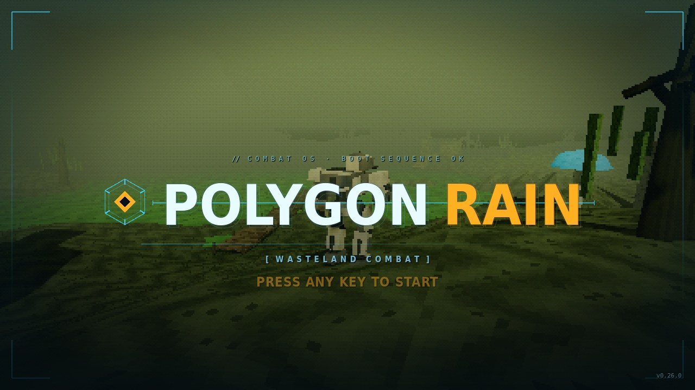 *Title screen* | 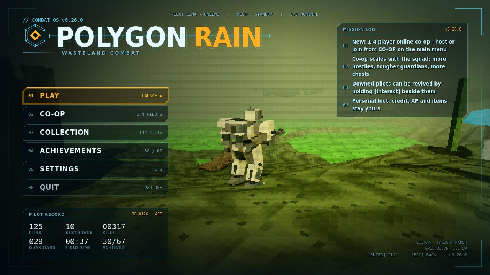 *Main menu (new CO-OP entry)* |
| 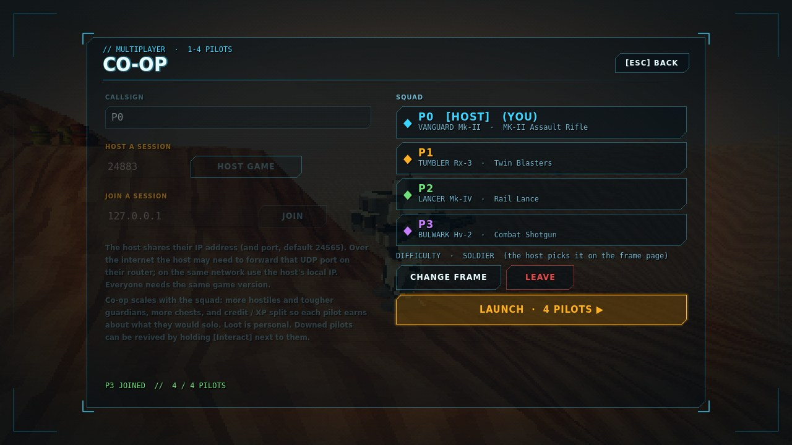 *Co-op lobby: a full squad of four* | 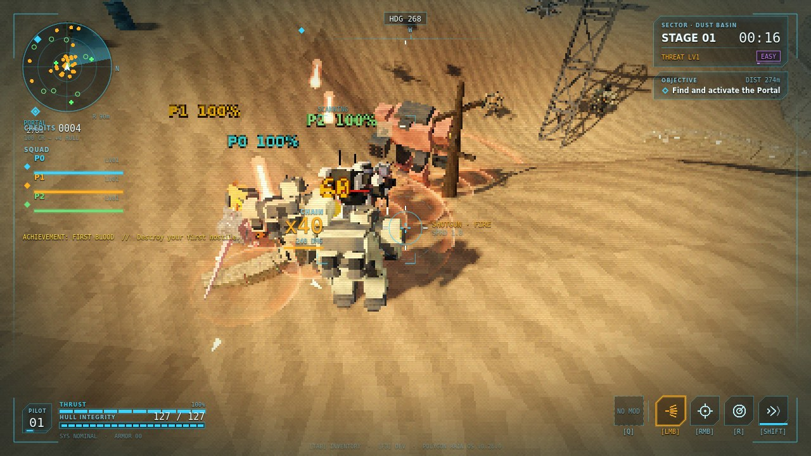 *Co-op: the squad in a fight* |
| 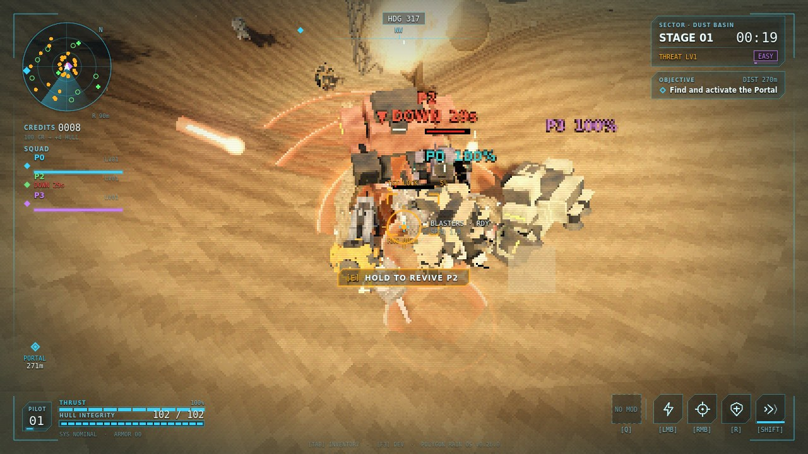 *Co-op: hold Interact to revive a downed teammate* | 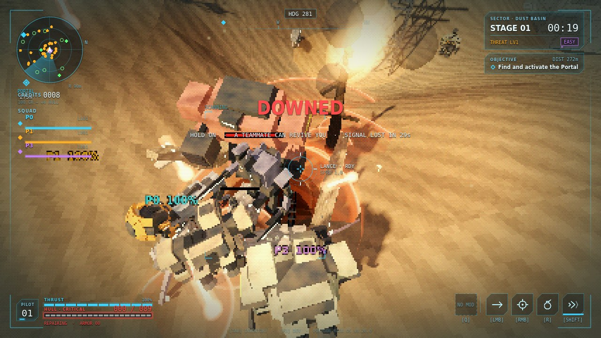 *Co-op: downed, waiting for a revive* |
| 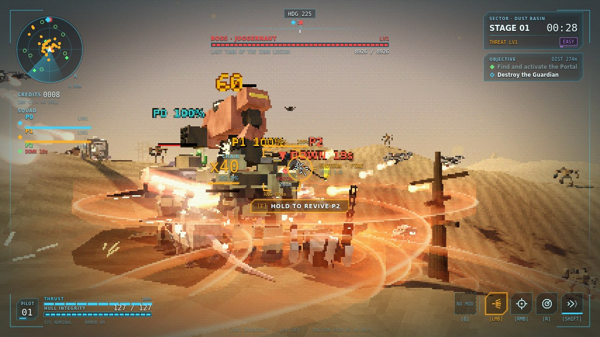 *Co-op: a guardian fight* | 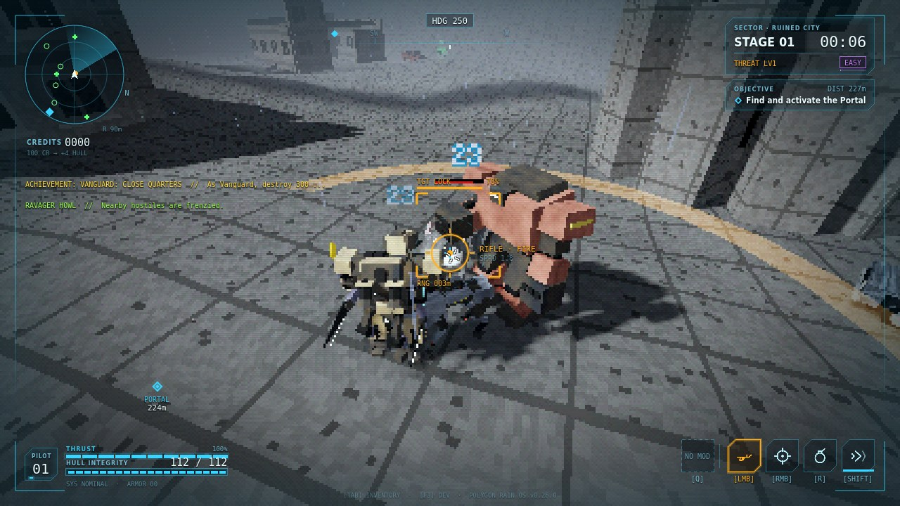 *Vanguard - Ruined City* |
| 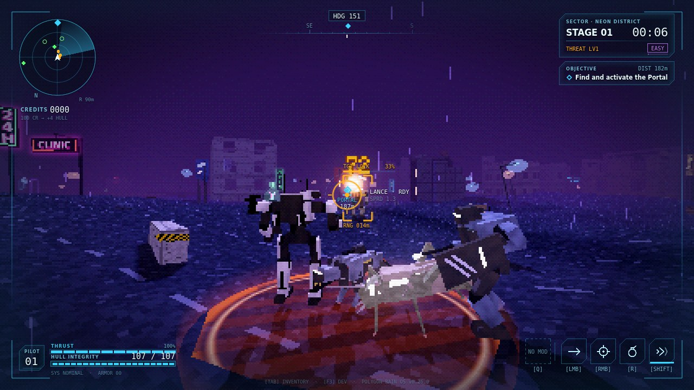 *Lancer - Neon District* | 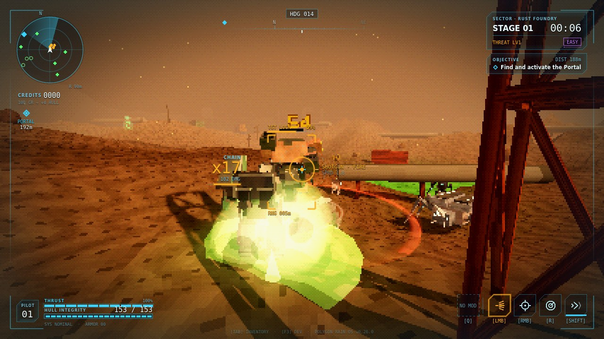 *Bulwark - Rust Foundry* |
| 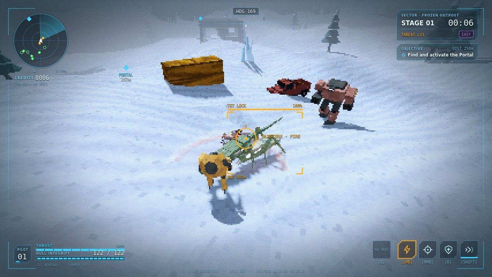 *Tumbler - Frozen Outpost* |  *The Leviathan main cannon* |

## Controls

| Key | Action |
|---|---|
| WASD | Move |
| Space | Jump / hold to jetpack-hover |
| Ctrl | Sprint (Tumbler: roll into a ball) |
| LMB / RMB | Primary weapon (Lancer: hold to charge) / piercing shot |
| R | Grenade / missile pod / bubble shield (depends on the mech) |
| Shift | Dash |
| Q | Ultimate |
| E | Interact |
| G / Middle mouse | Ping |
| Tab | Inventory |
| Esc | Pause / settings |

Every key can be rebound in Settings > Controls, and controllers are supported. The drop pod intro can be skipped with jump or fire, or turned off in Settings > Controls > Interface.

## About this repo

This repository hosts playable builds plus the game's artwork and screenshots (`media/`). Each release includes the changelog and screenshots for that version.
